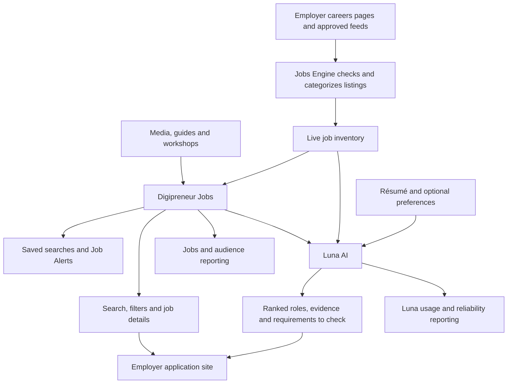

# What I built across Digipreneur

[Back to the case study](README.md) · [Visit the Network](https://digipreneur.network/) · [Browse Jobs](https://digipreneur.network/jobs/) · [Try Luna AI](https://digipreneur.network/jobs/match/)

I started with a Caribbean media platform, then built a remote jobs board to help readers act on what they were learning. Luna came next, after job seekers started sending me résumés and asking where they should apply. This is the feature inventory behind that story.

## Digipreneur Network

| Area | What I built |
| --- | --- |
| **Editorial platform** | A WordPress publication organized around technology, AI and the digital economy, digital business, the creator economy, careers and skills, Caribbean perspectives, and digital life. The site brings my articles, interviews, radio, TV, podcast, and newspaper work into one place. [Explore the Network](https://digipreneur.network/) |
| **Discovery and audience** | Responsive navigation, site search, a Resources menu and hub, light and dark modes, newsletter signup, a story pitch form and routes to contact me. These give readers ways to find another useful story, return to the site, send an idea, or get in touch. [Resources](https://digipreneur.network/resources/) · [Pitch a Story](https://digipreneur.network/pitch-a-story/) |
| **Media and events** | A Digipreneur FM home for the podcast and a Digital Nomad Summit replay hub with speaker-by-speaker navigation. The Summit brings Caribbean perspectives on remote work and building across borders into the same site as the resources and jobs. [Digipreneur FM](https://digipreneur.network/digipreneur-fm/) · [Summit replay](https://digipreneur.network/digital-nomad-summit-2026/) |
| **Career learning** | A free workshop with a replay, research downloads, guided AI exercises, and a practical path from choosing a direction to building proof of skills. The AI Literacy Baseline gives beginners a course sequence and a place to start practising. [Digital Careers Workshop](https://digipreneur.network/the-digital-careers-workshop/) · [AI Literacy Baseline](https://digipreneur.network/the-ai-literacy-baseline/) |
| **Cross-border resources** | A payments resource hub to help people plan how to receive and use money across borders, and a destination guide with comparisons and a guided AI exercise for building a shortlist. [Digital Payments Resource Hub](https://digipreneur.network/digital-payments-resource-hub/) · [Digital Nomad Destination Guide](https://digipreneur.network/top-digital-nomad-destinations-2027/) |
| **Search and distribution** | Editorial SEO and social sharing metadata, mobile layouts, and job guides and industry reports that lead readers into the board. I use analytics to study how readers arrive and which actions they take. [Software & IT industry report](https://digipreneur.network/remote-software-it-jobs-industry-report-2026/) |

The Network also has an internal **QR Studio** for generating and managing trackable campaign links. I used the dynamic QR workflow to take people from Summit promotion to the replay page.

## Digipreneur Jobs

### What job seekers can do

- **Browse for free.** Search by role, company, or skill without creating an account. Suggestions, common abbreviation choices, and typo corrections help people recover from an imprecise search.
- **Filter and sort the live inventory.** Narrow by career field, job type, seniority, employer-disclosed pay, or posting date. Browse by relevance, newest listings, or trending roles. Dedicated field pages make it easier to return to a particular area.
- **Read the employer's terms up front.** Cards surface hiring location, work hours or time-zone overlap, job type and pay where stated. A remote role can still have a country restriction, work-hour requirement, or travel policy.
- **Open a job without losing your place.** Read the full advert in a job details popup, share the listing or apply directly with the employer. Desktop and mobile use the same underlying inventory.
- **Get Job Alerts.** Save up to ten searches and receive a single combined browser notification when new live jobs match, at most once in 24 hours and scheduled around your local morning. You can remove searches or turn alerts off. Overlapping searches are combined so the same vacancy appears once in a digest.

[Browse the live jobs board](https://digipreneur.network/jobs/)

### How the inventory stays useful

| Capability | What it does |
| --- | --- |
| **Employer discovery and source intake** | Trace promising leads to original careers pages and approved feeds. Connect recurring sources through employer career sites and recruitment platforms such as Greenhouse, Lever, and Ashby. Keep source submissions and research history available for review. |
| **Import and normalization** | Read different employer formats into a common vacancy record. Keep the original title, employer, link and advert evidence. Normalize career field, work type, experience level, location, and any stated pay or working hours. |
| **Eligibility review** | Use the wording in the original advert to distinguish worldwide hiring, regional eligibility, and country restrictions. Hold ambiguous or conflicting cases for review. Keep the evidence attached to the decision so that material edits can trigger another check. |
| **Freshness and duplicate control** | Detect duplicate records, recheck active postings, and retire or hide stale and closed roles. Track source health and retry temporary feed or detail-page failures so an import problem is visible to the operator. |
| **Search and delivery** | Use an index for relevance and filter counts, check that jobs are still eligible to display, and keep a fallback search path. Paginate the results and load job details on demand. The board and Luna draw from the same live inventory. |
| **Research workflow** | I gave four specialist Grok agents recurring research roles across employer discovery, source verification, labour-market analysis, and quality review. Their work feeds an evidence and review workflow. Source approval and publication follow the Jobs Engine's rules and review process. |

### What I can see in WordPress

- **Overview and marketing reporting** bring together inventory, new jobs, audience activity, and paths into the board. The views help me distinguish landing traffic, engagement, job-detail views, and outbound apply clicks.
- **Engine Operations and Engine Command Centre** show import and source health, pending work, review outcomes, and exceptions. Research History and Source Intake preserve where a lead came from and how it was handled.
- **Job Trends, Job-Market Intelligence, and Reporting Studio** help me compare fields, work arrangements, and employer-stated pay and requirements. I can use patterns in the underlying adverts to produce public career guides and industry reports. The operational dashboards use scheduled snapshots with freshness indicators. Audience reporting can bring in GA4 and search data alongside site activity, with separate views for tools such as Clarity and HubSpot.

An employer apply click is the handoff I can measure on Digipreneur. Employers handle the application and its outcome. [See a public example of the research](https://digipreneur.network/remote-software-it-jobs-industry-report-2026/)

## Luna AI

### From résumé to decisions

1. **Start with your experience.** Upload a PDF with readable text or a Word file, or paste résumé text. On desktop the form supports drag and drop. If a document cannot be read or accepted, the form offers another file or pasted text where supported.
2. **Set optional preferences.** Choose one or several fields, full-time or part-time, and whether to explore paid roles, internships, or volunteering. Leave them open for a wider search.
3. **Check what Luna understood.** Review the skills and experience it picked up and make corrections. Change preferences and update the ranking without uploading again.
4. **See ranked roles as work finishes.** Browse the first results as they arrive. Explanations appear progressively, and you can request explanations for more roles when that control is available.
5. **Explore and apply.** Switch among top matches and broader suggestions, filter by date, sort by best match or newest, and page through roles. Lower-ranked jobs get a useful job preview. Open the full advert in a popup without leaving the results and apply directly on the employer's site.

[Try Luna AI](https://digipreneur.network/jobs/match/) · [Read the launch story](https://digipreneur.network/luna-ai-remote-job-matcher/)

### How matching and explanations work

- **Live jobs, structured evidence.** Luna compares the résumé with the current Jobs inventory. The engine considers role duties, skills, relevance, and the user's preferences. GPT-6 Luna, through the OpenAI Responses API, supports résumé interpretation and explanation generation.
- **The first five matter.** The ranking accounts for demonstrated work across more than one career. A responsibility performed by a colleague or supervisor gives context, while evidence that the applicant personally did the work can support the match. Suitable candidates can include roles with titles the applicant has never held.
- **Explain the gap.** The cards distinguish what the employer asks for, what the résumé supports, and what remains to verify. For bundled requirements, Luna can credit the duties shown and identify the specific missing part. The evidence informs the difference between a Strong Match and transferable or stretch experience.
- **Prepare jobs ahead of the session.** The recurring Batch process prepares reusable summaries of new and updated public adverts. It checks that cards still correspond to current adverts before they are used. Résumé-specific matching and explanations happen during the user's own session.
- **Keep the session private.** A user can revisit results in the same browser for up to 24 hours and delete their profile and matches sooner. Luna never submits applications or sends résumés to employers.
- **Make the experience reliable.** Progress shows what has completed. Background workers, staged responses, caching for the public landing, and private concurrent-session tests support the workflow. The most recent reliability work added clearer Word file recovery and finer timing for ranking and explanation verification.

### Reporting and ongoing improvement

The **Luna dashboard** sits under Digipreneur Jobs in WordPress. It tracks landing views, started matches, ranked and explained results, input types, time to results, errors, employer clicks, and API service and cost. A sortable table shows which career fields people asked for and which fields actually appeared. That distinction helps me investigate whether an issue comes from the vacancies available or how they were ranked.

I use aggregate reporting and fictional résumé test cases to reproduce problems. Examples include archives, payroll, procurement, community operations, and people with careers spanning multiple fields. A release is tested against the current version to check the first five, whether claims are grounded in the résumé, and whether the workflow holds up with simultaneous sessions.

## How the products fit together

