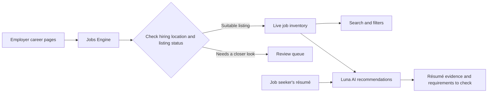

# Digipreneur Jobs & Luna AI

**A remote jobs platform built for people in the Caribbean and beyond.**

I’m Keron Rose, founder of Digipreneur Network. I built the Jobs Engine to find remote opportunities people in our region could realistically explore. I built Luna AI after people started sending me résumés and asking which jobs they should look at. Together, they help readers go from discovering opportunities to making a more informed decision about where to apply.

[**Explore the job board**](https://digipreneur.network/jobs/) · [**Try Luna AI**](https://digipreneur.network/jobs/match/) · [**Read the build story**](https://digipreneur.network/luna-ai-remote-job-matcher/)

## From employer listing to useful recommendation

### Digipreneur Jobs Engine

“Remote” can cover very different hiring arrangements. The engine brings listings in from employer sources, records what the employer says about where it hires and how the work is arranged, and routes ambiguous cases for review. The public job board lets people browse that inventory through search and filters.

The product decision I care most about here is knowing when a listing needs another look. A broad label on a job ad is easy to display. Giving someone the details they need before they invest time applying is more valuable.

### Luna AI

Luna reads a résumé, compares the experience it finds with live jobs from the inventory, and explains the match using the job ad and résumé. It also highlights requirements to check, so the reader can decide which roles are worth exploring.

One of the harder cases is a résumé that spans two careers. A person can have years in payroll and still be looking for procurement work. I use fictional résumés and real public ads to check whether both paths surface when the inventory supports them, and whether the explanations stick to what the résumé actually says.

## A release in practice

A test résumé read, “My director negotiated supplier contracts and I issued purchase orders.” Those are different pieces of work. We traced where Luna could credit the applicant for the negotiation and fixed that path. It now preserves the purchase-order evidence and excludes the director’s negotiation from the assessment, the explanation, and the Strong Match decision.

The same release addressed job ads that list several duties in one sentence. We verified that Luna recognizes résumé evidence for building, testing, and deploying software, and still flags a real gap when a résumé shows payroll audits and reconciliation but leaves out resolving payroll queries.

**All 21 targeted checks passed on the private candidate and again after release.** These checks used fictional examples and tested the specific evidence behavior described above.

## What this project demonstrates

- **Product strategy.** Start with a real audience problem, then connect two products that make the next step easier.
- **Data operations.** Collect and maintain a changing inventory and keep uncertain decisions visible for review.
- **Applied AI.** Connect recommendations to source evidence, test edge cases, and verify changes before they reach users.
- **Digital growth.** Bring together a useful tool, editorial content, and distribution on a platform I own and operate.

I build projects like this to turn a clear business problem into something people can use, and to make the work behind the product visible. If you’d like to talk about digital strategy, AI-enabled products, or building a platform for your audience, [get in touch with me](https://keronrose.com/).
