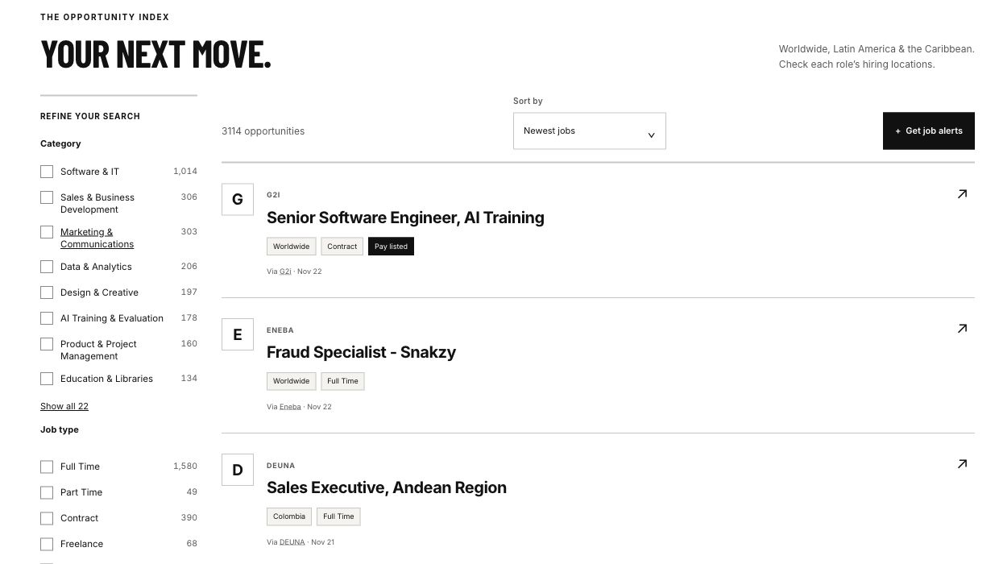

# Digipreneur Network

**A Caribbean media and resource platform for people building businesses, careers, and income in the digital economy.**

I’m Keron Rose. I built Digipreneur Network to bring years of work in digital business, marketing, e-commerce, and technology into one place I own. Then I built two products around problems I kept seeing. **Digipreneur Jobs** helps people find remote opportunities they can realistically pursue. **Luna AI** helps them work out which of those jobs fit the experience they already have.

[**Explore Digipreneur Network**](https://digipreneur.network/) · [**Browse Digipreneur Jobs**](https://digipreneur.network/jobs/) · [**Try Luna AI**](https://digipreneur.network/jobs/match/) · [**See everything I built**](FEATURES.md)

## The project at a glance

| Product | What I built | Explore |
| --- | --- | --- |
| **Digipreneur Network** | A Caribbean editorial platform with media, a newsletter, a replay hub, and practical resources for digital careers, payments, and working across borders. | [Resource hub](https://digipreneur.network/resources/) |
| **Digipreneur Jobs** | A live remote job board with employer-source checks, search, filters, Job Alerts, and dashboards for the inventory, operations, audience, and job market. | [Live jobs board](https://digipreneur.network/jobs/) |
| **Luna AI** | A résumé matcher with ranked live jobs, evidence-based explanations, and a dashboard that tracks usage, match delivery, and reliability. | [Try Luna](https://digipreneur.network/jobs/match/) · [See a sample result](#a-sample-luna-result) |

## See the products in action

[**Take the visual tour**](VISUAL-TOUR.md) to see Job Alerts, the Jobs and Luna reporting dashboards, and a Luna result with fictional résumé evidence.

## Why I built the Network

For years, my work lived across radio, television, newspaper columns, podcasts, workshops, and social media. Somebody might hear me on *The Digital World* or see a CNC3 segment, then have to look somewhere else for the resources that would help them act on it. I wanted one home for that work, and somewhere I could build the resources I kept wishing existed for our region.

Living in Asia gave me another view of how people use technology, get paid, and build businesses across borders. I wanted to bring those conversations back to the Caribbean in a way people here could use. Today, the Network brings together original media and resources like the [Digital Payments Resource Hub](https://digipreneur.network/digital-payments-resource-hub/) and the [Digital Nomad Destination Guide](https://digipreneur.network/top-digital-nomad-destinations-2027/).

I added a [Digital Careers Workshop](https://digipreneur.network/the-digital-careers-workshop/), an [AI Literacy Baseline](https://digipreneur.network/the-ai-literacy-baseline/), and a [Digital Nomad Summit replay hub](https://digipreneur.network/digital-nomad-summit-2026/). Together with [Digipreneur FM](https://digipreneur.network/digipreneur-fm/), the newsletter, and the story pitch form, they give people more ways to learn, return, and contribute.

It’s also my sandbox. I can try an idea, put it in front of real people, learn from how they use it, and show what I built and why. [Read my launch column in the *Trinidad and Tobago Guardian*.](https://www.guardian.co.tt/business/the-digipreneur-network-is-now-live-6.2.2684485.093e3008ba)

## Digipreneur Jobs makes remote opportunities easier to find

For someone in the Caribbean, the word “remote” can send you halfway through an application before you discover the employer hires in one country. I wanted people to see those terms sooner, whether they planned to work from home, move abroad, or work while travelling.

I built the Jobs Engine behind the board to connect to employer sources, capture new listings, and check what the employer actually says about hiring locations and working hours. Listings with unclear eligibility can go into review. The engine keeps a live inventory that visitors can search, filter, and use to go directly to the employer.

### Job Alerts give people a reason to return

A job seeker can save a search and get a browser notification when new records meet it. If several saved searches find the same vacancy, the system sends it once in a combined digest. People can remove a search or turn alerts off. This gives them a way to follow openings in their field without repeating the same search every morning.

### The dashboard behind the board

I built reporting for the work that happens after launch. The Overview brings together audience behavior and inventory. Engine Operations helps me find stalled sources, review listings and clear exceptions. Job Trends and Reporting Studio turn employer-stated requirements, pay disclosures and work arrangements into evidence I can use in public guides. That is how the same inventory supports a job seeker and a piece of editorial research. [See the Software & IT industry report.](https://digipreneur.network/remote-software-it-jobs-industry-report-2026/)

I also built a specialist AI research workflow around discovery, verification, labour-market research, and quality review. The team traces leads to original employer sources and records evidence for the engine and editorial review process.

That makes Jobs part of a wider journey on the Network. You can look for work, explore where you might live, and figure out how to receive payments across borders.

## Luna AI answers the question people kept asking me

After launching Jobs, people started sending me résumés by email and DM and asking, “Keron, which jobs should I look at?” I was getting annoyed enough to consider making a video asking people to stop. Then it hit me that they were showing me what the board was missing. They could see the opportunities. They still wanted help deciding where to start.

People were already using the board. When I introduced Luna, I shared that more than **13,000 people** visited the platform in the first month, and reporting recorded more than **5,000 clicks through to employer application pages**. Those clicks measure the step we can observe on our side. The messages told me what the numbers couldn’t, and I spent four days building the first version of Luna. [Read the Luna launch story.](https://digipreneur.network/luna-ai-remote-job-matcher/)

Luna lets someone start with their résumé. It compares their experience with live jobs, surfaces roles they might never have known to search for, and explains which duties their experience supports and which requirements they still need to check. The applicant decides where to apply.

### A sample Luna result

**Payroll Operations Coordinator** · Fictional example based on a QA test

| What the employer asks for | What the résumé shows | What to check |
| --- | --- | --- |
| “Audit timecards, reconcile deductions, and resolve payroll queries.” | “I audit timecards and reconcile deductions.” | The résumé covers the first two duties. It gives no example of resolving payroll queries. |

That’s the kind of result I wanted Luna to give people. You can see where your experience overlaps and what you’d want to confirm before applying.

### From the first build to Luna 2.5

| Stage | What changed for users |
| --- | --- |
| **Prototype and V1** | I turned the inbox request into a public tool. People could upload or paste their résumé, get ranked live jobs with explanations, and choose where to apply. |
| **V2** | We improved the first results and tightened the link between a job requirement and the passage that supports it. We tested where the first five could be stronger and where an explanation was making a claim the résumé did not support. |
| **2.5 and follow-up releases** | Luna got better at handling mixed careers, multiple duties in one job requirement, and work performed by somebody else. We added reusable job cards for new and changed adverts, clearer upload recovery, and more detailed performance tracking. |

Luna uses **GPT-6 Luna** (`gpt-6-luna`) through the **OpenAI Responses API**. The application supplies current vacancies and checks the model’s claims against the job advert and résumé evidence. Job details open in the results, and people can sort by recency, refine preferences, and update the ranking without starting over.

### How I know where to improve Luna

Luna’s dashboard shows how many sessions start, reach ranked jobs and get explanations. It shows which career fields people request and which appear in results, plus upload errors, time to results, employer-link clicks and API spend. That lets me investigate whether a weak first page comes from limited inventory, how we ranked it, or what we said about a genuinely relevant role.

### A release in practice

A fictional résumé said, “My director negotiated supplier contracts and I issued purchase orders.” The matcher could credit the applicant for the negotiations. The fix keeps the applicant’s purchase-order experience and excludes the director’s work from the explanation and Strong Match decision.

The same release improved how Luna handles adverts that bundle several duties into one sentence. It now handles the building, testing, and deployment example without inventing a gap, while still flagging a missing duty such as resolving payroll queries. **All 21 targeted checks passed** on the private candidate and again after release. The checks used fictional examples.

### Making Luna feel faster

I tested the full journey from résumé upload to opening a job. The new release shows elapsed time and explains longer waits. When Luna can’t read a file, you can immediately paste the text or choose another file. Luna also loads nearby results pages and job details ahead of time so you can keep exploring while explanations arrive.

I verified the changes on desktop and at mobile width, including slow connections and stalled requests. The reporting dashboard counts sessions where someone actually opened a job, with automatic preloads excluded.

## Explore the build

The [full feature inventory](FEATURES.md) walks through the Network's publishing and resource tools, the Jobs Engine's source and review workflow, Job Alerts, both reporting systems, and how Luna earns a match recommendation. It includes a diagram of how all three products connect.

## Why I’m building in public

I work in digital strategy, marketing, e-commerce, and audience growth. I wanted a portfolio someone could actually use. A client or employer can browse the Network, try the tools, and ask me about the product and editorial choices, how I found and measured demand, or what changed after launch. I can show them the live experience and explain the work behind it.

That’s what connects all three projects for me. The Network gives my work a home. Jobs makes opportunities easier to find. Luna helps people make sense of those opportunities using their own experience.

[**Try Luna AI**](https://digipreneur.network/jobs/match/) · [**More about my work**](https://keronrose.com/about-keron-rose/) · [**Get in touch**](https://digipreneur.network/contact/)
