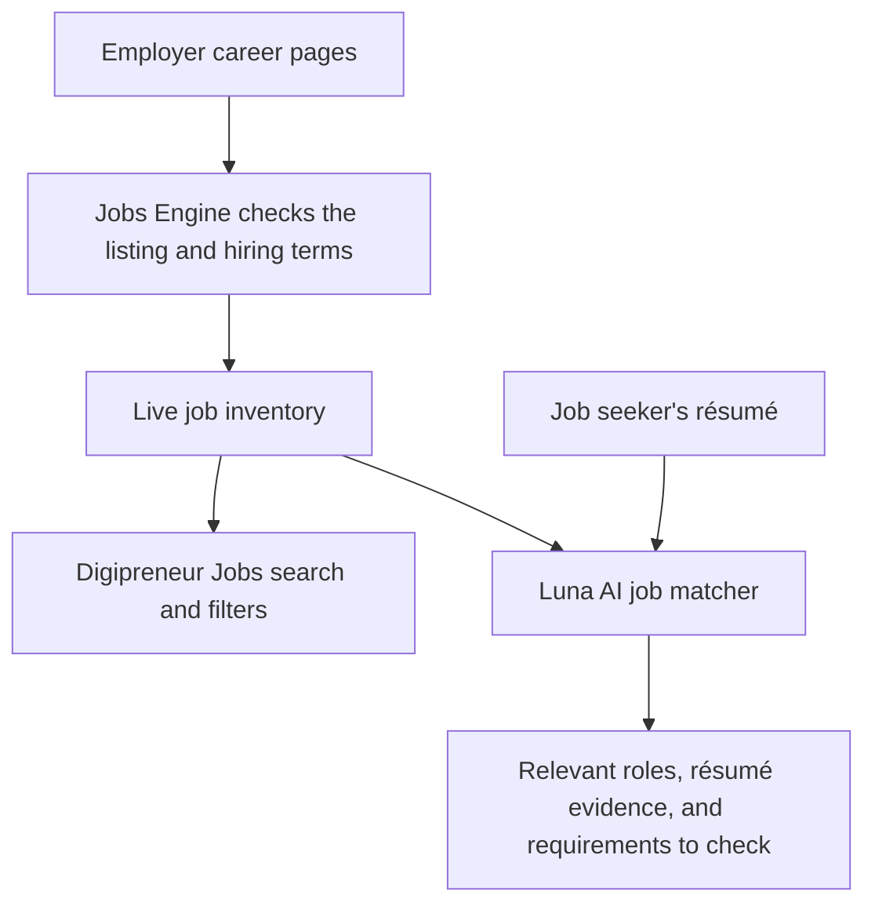

# Digipreneur Network

**A Caribbean media and resource platform for people building businesses, careers, and income in the digital economy.**

I’m Keron Rose. I built Digipreneur Network to bring years of work in digital business, marketing, e-commerce, and technology into one place I own. Then I built two products around problems I kept seeing. **Digipreneur Jobs** helps people find remote opportunities they can realistically pursue. **Luna AI** helps them work out which of those jobs fit the experience they already have.

[**Explore Digipreneur Network**](https://digipreneur.network/) · [**Browse Digipreneur Jobs**](https://digipreneur.network/jobs/) · [**Try Luna AI**](https://digipreneur.network/jobs/match/)

## Why I built the Network

For years, my work lived across radio, television, newspaper columns, podcasts, workshops, and social media. Somebody might hear me on *The Digital World* or see a CNC3 segment, then have to look somewhere else for the resources that would help them act on it. I wanted one home for that work, and somewhere I could build the resources I kept wishing existed for our region.

Living in Asia gave me another view of how people use technology, get paid, and build businesses across borders. I wanted to bring those conversations back to the Caribbean in a way people here could use. Today, the Network brings together original media and resources like the [Digital Payments Resource Hub](https://digipreneur.network/digital-payments-resource-hub/) and the [Digital Nomad Destination Guide](https://digipreneur.network/top-digital-nomad-destinations-2027/).

It’s also my sandbox. I can try an idea, put it in front of real people, learn from how they use it, and show what I built and why. [Read my launch column in the *Trinidad and Tobago Guardian*.](https://www.guardian.co.tt/business/the-digipreneur-network-is-now-live-6.2.2684485.093e3008ba)

## Digipreneur Jobs makes remote opportunities easier to find

For someone in the Caribbean, the word “remote” can send you halfway through an application before you discover the employer hires in one country. I wanted people to see those terms sooner, whether they planned to work from home, move abroad, or work while travelling.

I built the Jobs Engine behind the board to connect to employer sources, capture new listings, and check what the employer actually says about hiring locations and working hours. Listings with unclear eligibility can go into review. The engine keeps a live inventory that visitors can search, filter, and use to go directly to the employer.

That makes Jobs part of a wider journey on the Network. You can look for work, explore where you might live, and figure out how to receive payments across borders.

## Luna AI answers the question people kept asking me

After launching Jobs, people started sending me résumés by email and DM and asking, “Keron, which jobs should I look at?” I was getting annoyed enough to consider making a video asking people to stop. Then it hit me that they were showing me what the board was missing. They could see the opportunities. They still wanted help deciding where to start.

People were already using the board. When I introduced Luna, I shared that more than **13,000 people** visited the platform in the first month, and reporting recorded more than **5,000 clicks through to employer application pages**. Those clicks measure the step we can observe on our side. The messages told me what the numbers couldn’t, and I spent four days building the first version of Luna. [Read the Luna launch story.](https://digipreneur.network/luna-ai-remote-job-matcher/)

Luna lets someone start with their résumé. It compares their experience with live jobs, surfaces roles they might never have known to search for, and explains which duties their experience supports and which requirements they still need to check. The applicant decides where to apply.

### How the two products work together

Luna AI uses **GPT-6 Luna** (`gpt-6-luna`) through the **OpenAI Responses API** to interpret résumé experience and help explain job recommendations. The application supplies the live listings and checks the model’s claims against the employer advert and résumé evidence before displaying the explanations.

### A release in practice

A fictional résumé said, “My director negotiated supplier contracts and I issued purchase orders.” The matcher could credit the applicant for the negotiations. The fix keeps the applicant’s purchase-order experience and excludes the director’s work from the explanation and Strong Match decision.

The same release improved how Luna handles adverts that bundle several duties into one sentence. It now handles the building, testing, and deployment example without inventing a gap, while still flagging a missing duty such as resolving payroll queries. **All 21 targeted checks passed** on the private candidate and again after release. The checks used fictional examples.

## Why I’m building in public

I work in digital strategy, marketing, e-commerce, and audience growth. I wanted a portfolio someone could actually use. A client or employer can browse the Network, try the tools, and ask me about the product and editorial choices, how I found and measured demand, or what changed after launch. I can show them the live experience and explain the work behind it.

That’s what connects all three projects for me. The Network gives my work a home. Jobs makes opportunities easier to find. Luna helps people make sense of those opportunities using their own experience.

[**Try Luna AI**](https://digipreneur.network/jobs/match/) · [**More about my work**](https://keronrose.com/about-keron-rose/) · [**Get in touch**](https://digipreneur.network/contact/)
