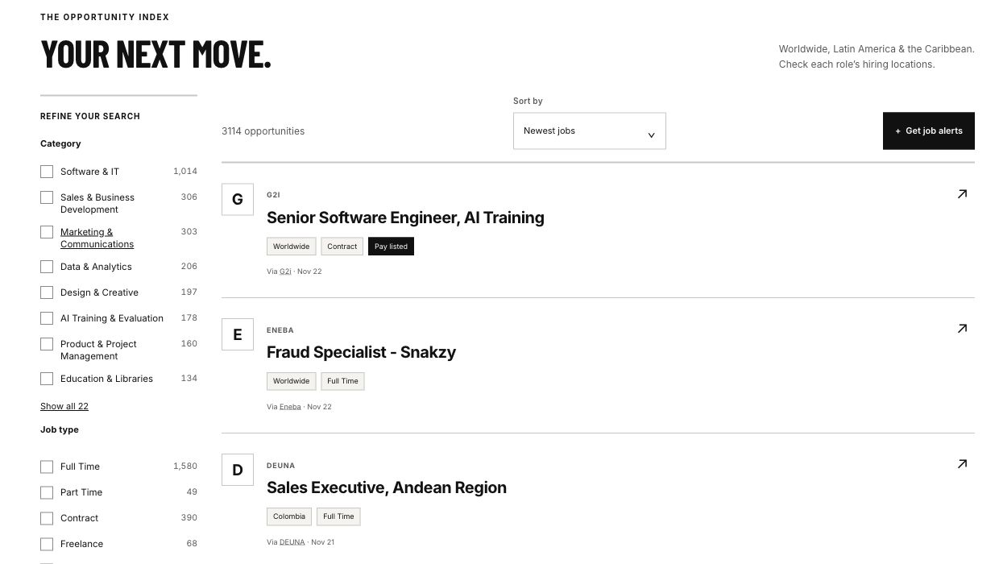
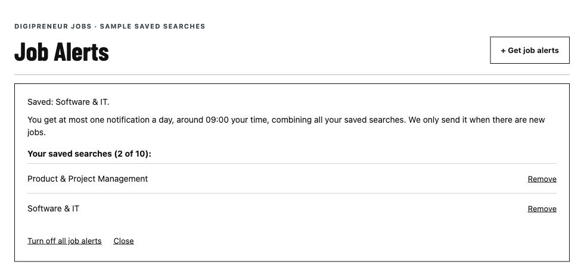
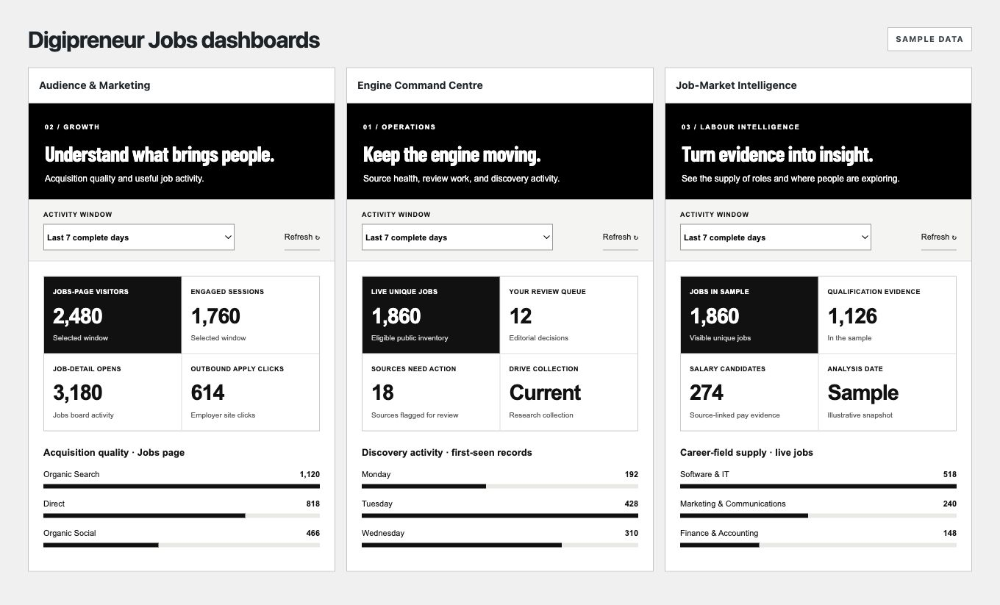
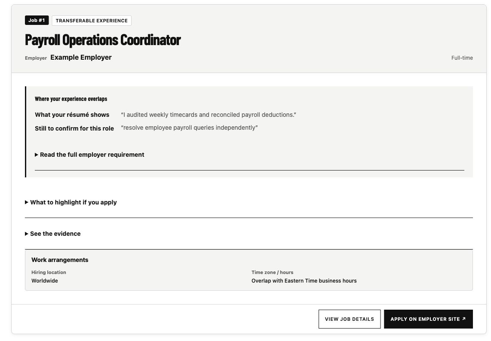
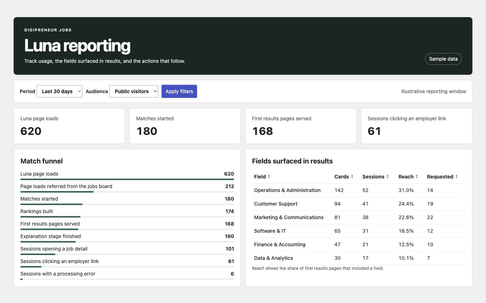

# Digipreneur product tour

[Back to the case study](README.md) · [Full feature inventory](FEATURES.md)

These screenshots show how people discover remote jobs, follow new openings, and use Luna to decide where to apply. The Job Alerts and dashboard previews use sample data. The Luna result uses a fictional résumé and job listing.

## Digipreneur Jobs board

Browse current openings and filter by career field or job type. The listings surface hiring locations and employer-disclosed pay so you can assess a role before opening the advert. [Browse the live board](https://digipreneur.network/jobs/)

## Job Alerts

Save the searches you want to follow. New matching jobs are grouped into one browser notification, at most once per day. This preview shows two sample saved searches and the controls for managing them.

## Jobs reporting dashboards

The three WordPress dashboards show where job seekers come from, how the engine is running, and what the inventory says about the job market. Outbound apply clicks measure visits to employer sites. Applications are handled by employers.

## Luna AI results

This fictional payroll example shows the evidence behind a recommendation. The résumé demonstrates timecard audits and deductions work. Luna isolates employee payroll queries as the duty to check before applying. The card also brings the work arrangements and job details into the results page. [Try Luna AI](https://digipreneur.network/jobs/match/)

## Luna reporting dashboard

The dashboard follows a session from landing and match start to results and employer-link clicks. It also compares the career fields people request with the fields that appear in their results.

